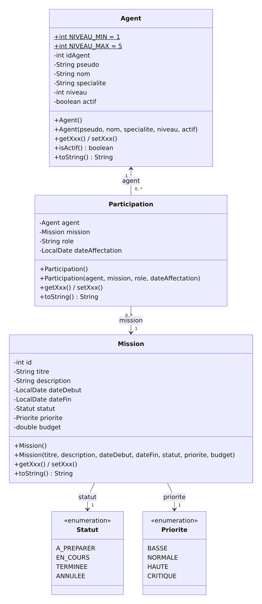
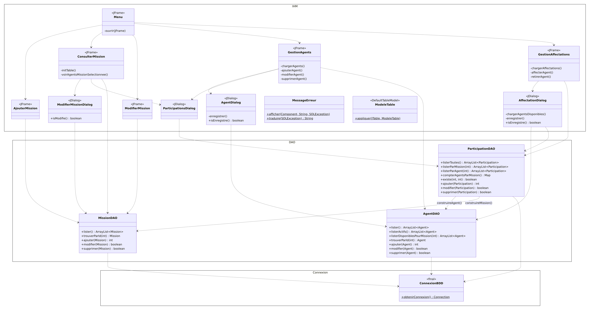

# Diagrammes de classes UML

Deux diagrammes complètent la [documentation technique](documentation-technique.md) :

1. le **modèle métier** (package `gestionmission.Metier`) ;
2. la **structure N-Tiers** : fenêtres (`IHM`), accès aux données (`DAO`) et connexion
   (`Connexion`), avec leurs dépendances.

Les sources des diagrammes sont au format [Mermaid](https://mermaid.js.org/) dans le dossier
[`diagrammes/`](diagrammes/) : elles peuvent être modifiées puis réexportées (par exemple avec
[mermaid.live](https://mermaid.live)).

Notation : `-` privé, `+` public ; un membre souligné est `static`.

---

## 1. Modèle métier

*Source : [diagrammes/uml-metier.mmd](diagrammes/uml-metier.mmd)*

Lecture du diagramme :

- **Participation** est la classe d'association entre **Agent** et **Mission** : elle porte le
  `role` et la `dateAffectation` (table associative `participation`).
- Une participation référence **exactement un** agent et **exactement une** mission ; un agent ou
  une mission peut être référencé par **0 à n** participations : c'est la relation
  plusieurs-à-plusieurs du MCD, décomposée en deux associations 1 — 0..*.
- `Statut` et `Priorite` sont des énumérations stockées en base sous forme d'`ENUM` MySQL.
- `Agent.NIVEAU_MIN` et `Agent.NIVEAU_MAX` sont des constantes de classe utilisées pour borner
  la saisie du niveau.

## 2. Structure N-Tiers

*Source : [diagrammes/uml-n-tiers.mmd](diagrammes/uml-n-tiers.mmd)*

Lecture du diagramme (flèches pointillées = dépendance « utilise ») :

- **IHM → DAO** : les fenêtres n'accèdent à la base qu'à travers les DAO.
- **DAO → ConnexionBDD** : chaque DAO obtient sa connexion par
  `ConnexionBDD.obtenirConnexion()`.
- **ParticipationDAO → AgentDAO / MissionDAO** : réutilisation de `construireAgent()` et
  `construireMission()` pour reconstruire les objets lus par jointure.
- Les stéréotypes `<<JFrame>>` et `<<JDialog>>` indiquent la classe Swing étendue : les
  formulaires de saisie et la consultation des affectations sont des fenêtres **modales**.
- Toutes les classes IHM et DAO manipulent les classes métier (dépendances non dessinées pour
  garder le schéma lisible : voir le diagramme précédent).

## 3. Tableau récapitulatif des classes

| Package | Classe | Responsabilité |
|---|---|---|
| `Metier` | `Mission`, `Statut`, `Priorite` | mission (TP1) |
| | `Agent` | agent de l'agence |
| | `Participation` | affectation d'un agent à une mission (rôle, date) |
| `DAO` | `MissionDAO` | CRUD de la table `mission` |
| | `AgentDAO` | CRUD de la table `agent`, agents disponibles pour une mission |
| | `ParticipationDAO` | CRUD de la table `participation`, lectures avec jointures |
| `Connexion` | `ConnexionBDD` | paramètres JDBC, ouverture des connexions |
| `IHM` | `Menu` | menu principal, ouverture des fenêtres |
| | `AjouterMission`, `ConsulterMission`, `ModifierMission`, `ModifierMissionDialog` | gestion des missions |
| | `GestionAgents`, `AgentDialog` | gestion des agents |
| | `GestionAffectations`, `AffectationDialog` | gestion des affectations |
| | `ParticipationsDialog` | consultation des agents d'une mission / des missions d'un agent |
| | `MessageErreur`, `ModeleTable` | utilitaires : messages d'erreur SQL, modèle de JTable |
