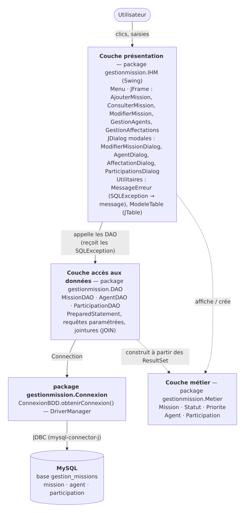
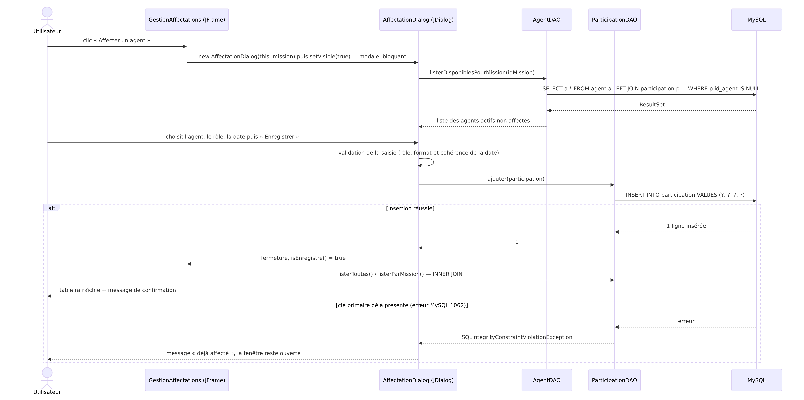
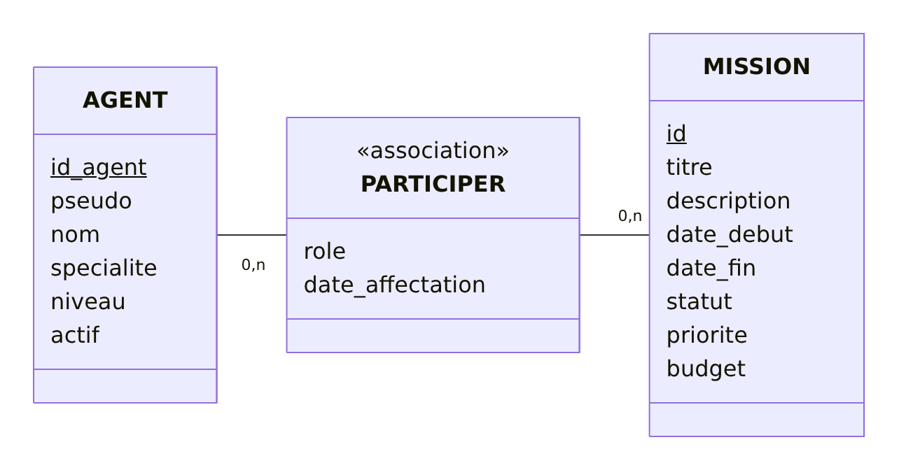
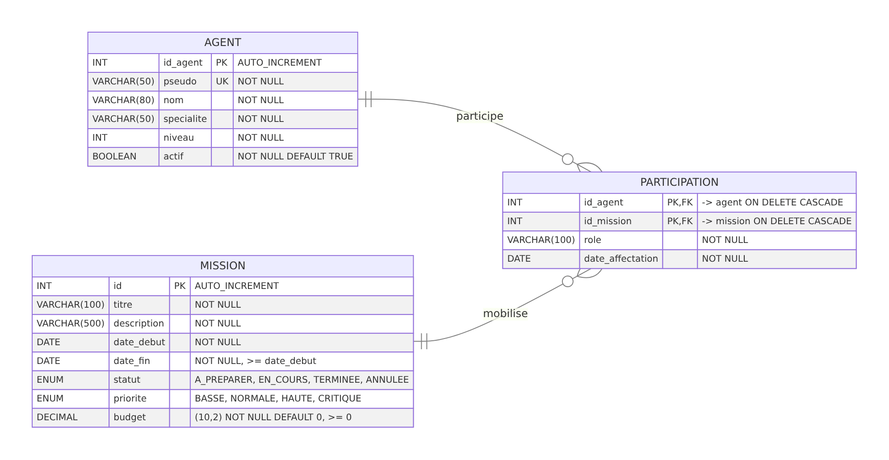

# Documentation technique — GestionMission (TP2)

> Projet DAO / JDBC — Gestion des agents et affectation aux missions.
> Ce document décrit l'architecture du projet, le schéma de la base de données et les choix
> techniques (requêtes SQL, jointures, gestion des exceptions).

## Sommaire

1. [Architecture globale](#1-architecture-globale)
2. [Base de données : MCD et MLD](#2-base-de-données--mcd-et-mld)
3. [Couche métier](#3-couche-métier)
4. [Couche DAO : requêtes SQL et jointures](#4-couche-dao--requêtes-sql-et-jointures)
5. [Gestion des exceptions et validation des saisies](#5-gestion-des-exceptions-et-validation-des-saisies)
6. [Couche présentation (Swing)](#6-couche-présentation-swing)
7. [Évolutions apportées au projet du TP1](#7-évolutions-apportées-au-projet-du-tp1)
8. [Tests réalisés](#8-tests-réalisés)

---

## 1. Architecture globale

L'application suit une architecture **N-Tiers** : chaque couche est un package Java et ne
communique qu'avec la couche voisine.



| Couche | Package | Rôle |
|---|---|---|
| Présentation | `gestionmission.IHM` | Fenêtres Swing : affichage (JTable), saisie (formulaires), validation des saisies, affichage des erreurs |
| Métier | `gestionmission.Metier` | Objets manipulés par l'application : `Mission`, `Agent`, `Participation` et les énumérations `Statut` / `Priorite` |
| Accès aux données | `gestionmission.DAO` | Une classe DAO par table : seules ces classes contiennent du SQL |
| Connexion | `gestionmission.Connexion` | `ConnexionBDD` centralise l'URL JDBC, l'utilisateur et le mot de passe |
| Données | MySQL | Base `gestion_missions` : tables `mission`, `agent`, `participation` |

Règles respectées :

- les fenêtres **n'écrivent jamais de SQL** : elles appellent les méthodes des DAO et manipulent
  des objets métier ;
- les DAO **ne font pas d'affichage** : ils propagent les `SQLException` à la couche présentation ;
- la configuration de la connexion se trouve **en un seul endroit** (`ConnexionBDD`).

### Exemple de dialogue entre les couches : affecter un agent



### Arborescence des sources

```
src/gestionmission/
├── GestionMission.java            test console des DAO
├── Connexion/
│   └── ConnexionBDD.java
├── Metier/
│   ├── Mission.java  Statut.java  Priorite.java      (TP1)
│   ├── Agent.java                                     (TP2)
│   └── Participation.java                             (TP2)
├── DAO/
│   ├── MissionDAO.java                                (TP1)
│   ├── AgentDAO.java                                  (TP2)
│   └── ParticipationDAO.java                          (TP2)
└── IHM/
    ├── Menu  AjouterMission  ConsulterMission  ModifierMission  ModifierMissionDialog  (TP1, .java + .form)
    ├── GestionAgents  AgentDialog                     (TP2)
    ├── GestionAffectations  AffectationDialog         (TP2)
    ├── ParticipationsDialog                           (TP2)
    └── MessageErreur  ModeleTable                     (TP2, utilitaires)
```

Les diagrammes de classes UML détaillés sont dans [diagramme-classes.md](diagramme-classes.md).

---

## 2. Base de données : MCD et MLD

### 2.1 Règles de gestion

- RG1 : un agent est identifié par un numéro ; son **pseudo est unique**.
- RG2 : un agent peut participer à **0, 1 ou plusieurs** missions.
- RG3 : une mission peut mobiliser **0, 1 ou plusieurs** agents.
- RG4 : pour chaque participation, on connaît le **rôle** de l'agent et sa **date d'affectation**.
- RG5 : un agent ne peut être affecté **qu'une seule fois** à une même mission.
- RG6 : un agent inactif est conservé (historique) mais ne peut plus être affecté.

### 2.2 MCD (Merise)



L'association **PARTICIPER** est porteuse de données (`role`, `date_affectation`) et ses deux
cardinalités maximales valent *n* : c'est une relation **plusieurs-à-plusieurs**.

### 2.3 MLD

Le passage au modèle logique transforme l'association n-n en **table associative** dont la clé
primaire est composée des deux clés étrangères :

- **mission** (<u>id</u>, titre, description, date_debut, date_fin, statut, priorite, budget)
- **agent** (<u>id_agent</u>, pseudo, nom, specialite, niveau, actif)
- **participation** (<u>#id_agent, #id_mission</u>, role, date_affectation)
  - `id_agent` : clé étrangère vers `agent(id_agent)`
  - `id_mission` : clé étrangère vers `mission(id)`



### 2.4 Contraintes du schéma physique

| Table | Contrainte | Rôle |
|---|---|---|
| `agent` | `PRIMARY KEY (id_agent)` + `AUTO_INCREMENT` | identifiant généré par MySQL |
| `agent` | `pseudo ... UNIQUE` | RG1 : deux agents ne peuvent pas avoir le même pseudo |
| `agent` | `actif BOOLEAN NOT NULL DEFAULT TRUE` | RG6 : désactiver un agent sans le supprimer |
| `participation` | `PRIMARY KEY (id_agent, id_mission)` | RG5 : pas de double affectation |
| `participation` | `FOREIGN KEY ... ON DELETE CASCADE` (x2) | supprimer un agent ou une mission supprime ses affectations (pas de ligne orpheline) |
| `mission` | `CHECK (date_fin >= date_debut)`, `CHECK (budget >= 0)` | contraintes du TP1, conservées |

Toutes les tables utilisent le moteur **InnoDB**, indispensable pour que MySQL applique les clés
étrangères.

### 2.5 Script SQL

[`sql/gestion_missions.sql`](../sql/gestion_missions.sql) contient le schéma complet et le jeu de
test (6 missions, 6 agents, 9 participations). Choix faits :

- `SET NAMES utf8mb4` en tête de script : les accents sont correctement enregistrés quel que soit
  l'outil d'import (sans cette ligne, un client configuré en latin1 enregistre « Lefèvre ») ;
- `CREATE TABLE IF NOT EXISTS`, `INSERT ... WHERE NOT EXISTS` et `INSERT IGNORE` : le script est
  **rejouable** et peut être exécuté sur une base TP1 existante sans perte de données ;
- les participations sont insérées en retrouvant les identifiants à partir du **pseudo** et du
  **titre** : le script ne dépend pas des valeurs générées par `AUTO_INCREMENT`.

---

## 3. Couche métier

| Classe | Table | Remarques |
|---|---|---|
| `Mission` | `mission` | inchangée par rapport au TP1 |
| `Agent` | `agent` | constantes `NIVEAU_MIN` / `NIVEAU_MAX` (1 à 5) utilisées par la saisie ; `toString()` renvoie « pseudo (nom) » pour les listes déroulantes |
| `Participation` | `participation` | contient des **références vers les objets** `Agent` et `Mission` (et non de simples identifiants) |

Le choix de références d'objets dans `Participation` correspond au diagramme de classes (deux
associations vers `Agent` et `Mission`) et évite aux fenêtres de faire des requêtes
supplémentaires : une seule requête avec jointures renvoie toutes les informations à afficher.

---

## 4. Couche DAO : requêtes SQL et jointures

### 4.1 Principes communs à tous les DAO

- **`PreparedStatement` systématique** : les valeurs saisies sont passées en paramètres (`?`) et
  jamais concaténées dans la requête, ce qui protège contre l'**injection SQL** et gère
  automatiquement les apostrophes (« Test d'intrusion »).
- **try-with-resources** : `Connection`, `PreparedStatement` et `ResultSet` sont fermés
  automatiquement, même en cas d'exception.
- **Une connexion par opération**, obtenue par `ConnexionBDD.obtenirConnexion()` : simple et
  suffisant pour une application monoposte.
- **`Statement.RETURN_GENERATED_KEYS`** à l'insertion d'un agent : l'identifiant généré par MySQL
  est recopié dans l'objet Java.
- Les méthodes de construction d'objets (`construireMission`, `construireAgent`) sont `static` et
  de visibilité *package* : `ParticipationDAO` les réutilise pour reconstruire les objets lus par
  jointure, sans dupliquer de code.

### 4.2 Requêtes avec jointures

**Lecture des participations (INNER JOIN)** — `ParticipationDAO` : `listerToutes()`,
`listerParMission(int)`, `listerParAgent(int)`.

```sql
SELECT p.role, p.date_affectation,
       a.id_agent, a.pseudo, a.nom, a.specialite, a.niveau, a.actif,
       m.id, m.titre, m.description, m.date_debut, m.date_fin, m.statut, m.priorite, m.budget
FROM participation p
INNER JOIN agent a   ON a.id_agent = p.id_agent
INNER JOIN mission m ON m.id       = p.id_mission
WHERE p.id_mission = ?          -- selon la méthode : rien, p.id_mission = ? ou p.id_agent = ?
ORDER BY a.pseudo
```

La jointure interne ne garde que les lignes qui ont une correspondance dans les trois tables.
Les colonnes sont listées explicitement (pas de `SELECT *`) pour éviter l'ambiguïté sur
`id_agent`, présent dans `agent` et `participation`.

**Agents disponibles pour une mission (LEFT JOIN ... IS NULL)** —
`AgentDAO.listerDisponiblesPourMission(int)`, utilisée par la fenêtre d'affectation :

```sql
SELECT a.* FROM agent a
LEFT JOIN participation p ON p.id_agent = a.id_agent AND p.id_mission = ?
WHERE a.actif = TRUE AND p.id_agent IS NULL
ORDER BY a.pseudo
```

La jointure externe garde tous les agents ; ceux qui ne sont **pas** affectés à la mission ont
des colonnes `p.*` à `NULL`. On ne propose donc que des agents actifs et non encore affectés :
l'utilisateur ne peut pas créer de doublon (RG5 et RG6).

**Nombre d'agents par mission (LEFT JOIN + GROUP BY)** —
`ParticipationDAO.compterAgentsParMission()`, utilisée par la colonne « Agents » de la fenêtre
*Consulter les missions* :

```sql
SELECT m.id, COUNT(p.id_agent) AS nb_agents
FROM mission m
LEFT JOIN participation p ON p.id_mission = m.id
GROUP BY m.id
```

Avec un `INNER JOIN`, les missions sans agent disparaîtraient du résultat ; le `LEFT JOIN` les
conserve avec un compteur à 0 (`COUNT(p.id_agent)` ne compte pas les `NULL`).

### 4.3 Récapitulatif des méthodes DAO

| DAO | Méthode | Requête |
|---|---|---|
| `AgentDAO` | `lister()` / `listerActifs()` | `SELECT * FROM agent [WHERE actif = TRUE] ORDER BY pseudo` |
| | `listerDisponiblesPourMission(id)` | `LEFT JOIN participation ... IS NULL` |
| | `trouverParId(id)` | `SELECT ... WHERE id_agent = ?` |
| | `ajouter(agent)` | `INSERT INTO agent ...` + clé générée |
| | `modifier(agent)` | `UPDATE agent SET ... WHERE id_agent = ?` |
| | `supprimer(agent)` | `DELETE FROM agent WHERE id_agent = ?` (cascade sur les participations) |
| `ParticipationDAO` | `listerToutes()` / `listerParMission(id)` / `listerParAgent(id)` | `INNER JOIN agent` + `INNER JOIN mission` |
| | `compterAgentsParMission()` | `LEFT JOIN` + `COUNT` + `GROUP BY` |
| | `existe(idAgent, idMission)` | `SELECT 1 ... WHERE id_agent = ? AND id_mission = ?` |
| | `ajouter(p)` | `INSERT INTO participation ...` |
| | `modifier(p)` | `UPDATE participation SET role = ?, date_affectation = ? WHERE id_agent = ? AND id_mission = ?` |
| | `supprimer(p)` | `DELETE FROM participation WHERE id_agent = ? AND id_mission = ?` |
| `MissionDAO` | CRUD du TP1 | inchangé |

---

## 5. Gestion des exceptions et validation des saisies

### 5.1 Principe : deux barrières

1. **Validation côté Java** (dans les fenêtres) avant tout accès à la base : l'utilisateur
   obtient un message précis et la fenêtre reste ouverte pour qu'il corrige.
2. **Contraintes côté base** (UNIQUE, clé primaire composée, clés étrangères, CHECK) : elles
   garantissent la cohérence même si la validation Java est contournée ou si deux utilisateurs
   travaillent en même temps. Leur violation produit une `SQLException` interceptée par l'IHM.

### 5.2 Propagation des exceptions

Les méthodes des DAO déclarent `throws SQLException` et ne l'interceptent pas : le DAO ne sait
pas comment informer l'utilisateur. Les fenêtres entourent chaque appel DAO d'un
`try / catch` :

```java
try {
    dao.ajouter(saisi);
    enregistre = true;
    dispose();
} catch (SQLIntegrityConstraintViolationException e) {
    // cas attendu : contrainte UNIQUE sur le pseudo
    MessageErreur.saisie(this, "Le pseudo « " + pseudo + " » est déjà utilisé par un autre agent.");
} catch (SQLException e) {
    // tout autre problème : serveur arrêté, table manquante...
    MessageErreur.afficher(this, "Enregistrement de l'agent", e);
}
```

- `SQLIntegrityConstraintViolationException` (sous-classe de `SQLException`, SQLState `23xxx`)
  est interceptée **en premier** pour les cas prévus : pseudo en double, agent déjà affecté.
- Les autres `SQLException` passent par la classe utilitaire **`MessageErreur`**, qui trace
  l'exception dans les logs et traduit le code d'erreur MySQL :

| Code / SQLState | Signification | Message affiché |
|---|---|---|
| SQLState `08xxx` | connexion impossible | « vérifiez que le serveur MySQL est démarré » |
| 1045 | accès refusé | « vérifiez l'utilisateur et le mot de passe dans ConnexionBDD » |
| 1049 | base inconnue | « exécutez le script sql/gestion_missions.sql » |
| 1146 | table inconnue | « exécutez le script sql/gestion_missions.sql » |
| 1062 | doublon | « cet enregistrement existe déjà » |
| 1451 / 1452 | clé étrangère | « élément encore utilisé » / « l'agent ou la mission n'existe plus » |
| 1406 | texte trop long | « un des textes saisis est trop long » |
| 3819 | contrainte CHECK | « une règle de la base n'est pas respectée » |

Quand un chargement échoue (ouverture d'une fenêtre), la table s'affiche vide avec le message
d'erreur au lieu de faire planter l'application.

### 5.3 Contrôles de saisie

| Fenêtre | Contrôle |
|---|---|
| `AgentDialog` | pseudo, nom et spécialité obligatoires |
| | pseudo sans espace : lettres, chiffres, `_`, `-`, `.` (expression régulière `[\p{L}\p{N}_.-]+`) |
| | longueurs maximales identiques aux colonnes SQL (50 / 80 / 50) |
| | niveau compris entre 1 et 5 (`JSpinner` borné + contrôle) |
| `AffectationDialog` | mission et agent obligatoires ; seuls les agents actifs non affectés sont proposés |
| | pas d'affectation sur une mission `ANNULEE` |
| | rôle obligatoire, 100 caractères maximum |
| | date au format `AAAA-MM-JJ` (`LocalDate.parse`, `DateTimeParseException` interceptée) |
| | date d'affectation au plus tard à la date de fin de la mission |
| Suppression | confirmation ; le nombre d'affectations supprimées en cascade est annoncé |

---

## 6. Couche présentation (Swing)

### 6.1 Multi-fenêtrage

- Le **Menu** ouvre chaque fenêtre principale (`JFrame`) en se masquant, puis réapparaît
  lorsqu'elle est fermée (`WindowListener.windowClosed`, `DISPOSE_ON_CLOSE`).
- Les formulaires et consultations ponctuelles sont des **`JDialog` modales**
  (`ModalityType.APPLICATION_MODAL`) : la fenêtre appelante est bloquée tant que la saisie
  n'est pas terminée, et `setVisible(true)` ne rend la main qu'à la fermeture.
- Chaque formulaire expose `isEnregistre()` : la fenêtre appelante ne recharge sa table que si
  une modification a réellement eu lieu.

| Fenêtre | Type | Ouverte depuis |
|---|---|---|
| `GestionAgents` | JFrame | Menu « Gérer les agents » |
| `AgentDialog` | JDialog modale | `GestionAgents` (Nouvel agent / Modifier / double-clic) |
| `GestionAffectations` | JFrame | Menu « Affecter les agents aux missions » |
| `AffectationDialog` | JDialog modale | `GestionAffectations` (Affecter / Modifier / double-clic) |
| `ParticipationsDialog` | JDialog modale | `ConsulterMission` (agents d'une mission) et `GestionAgents` (missions d'un agent) |
| `ModifierMissionDialog` | JDialog modale | `ConsulterMission` (double-clic) |

### 6.2 Tableaux (JTable)

- `ModeleTable` étend `DefaultTableModel` : cellules non éditables et type de colonne déduit
  des valeurs, ce qui donne un **tri correct** des nombres et des dates et l'affichage des
  booléens (`actif`) en cases à cocher.
- Le tri par clic sur l'en-tête est activé (`setAutoCreateRowSorter(true)`). Pour retrouver
  l'objet de la ligne sélectionnée, l'index affiché est converti avec
  `convertRowIndexToModel()` puis utilisé dans la liste d'objets chargée par le DAO.

### 6.3 Fenêtres conçues avec ou sans le GUI Builder

Les fenêtres du TP1 ont été conçues avec le GUI Builder de NetBeans (fichiers `.form`). Les
modifications du TP2 sur ces fenêtres (nouveaux boutons du Menu, bouton « Voir les agents
mobilisés ») ont été reportées **à la fois** dans le `.java` et dans le `.form`, pour que le
mode Design reste utilisable.

Les nouvelles fenêtres sont codées directement en Java (sans `.form`) avec des gestionnaires de
mise en page standard (`BorderLayout`, `GridBagLayout`, `FlowLayout`) : le code est plus court,
entièrement commenté et ne contient pas de bloc généré non modifiable.

---

## 7. Évolutions apportées au projet du TP1

| Fichier | Modification | Impact sur l'existant |
|---|---|---|
| `MissionDAO` | `construireMission` passe de `private` à `static` (visibilité package) | aucun |
| `ConsulterMission` (.java/.form) | colonne « Agents », bouton « Voir les agents mobilisés », message en cas d'erreur de chargement | ajout uniquement |
| `ModifierMissionDialog` (.java/.form) | `java.awt.Dialog` → `javax.swing.JDialog`, taille minimale, avertissement de suppression en cascade | même comportement |
| `Menu` (.java/.form) | deux boutons : agents, affectations | ajout uniquement |
| `GestionMission` | tests console des nouveaux DAO ajoutés après ceux du TP1 | ajout uniquement |
| `nbproject/project.properties` | classe principale : `gestionmission.IHM.Menu` | F6 lance l'application graphique |
| `sql/gestion_missions.sql` | tables `agent` et `participation`, jeu de test, `SET NAMES utf8mb4` | rejouable sur une base TP1 |

---

## 8. Tests réalisés

Les tests ont été exécutés sur MySQL 8.0 avec le jeu de données du script.

**Script SQL** : exécuté deux fois de suite → aucune erreur, toujours 6 missions, 6 agents et
9 participations (pas de doublon).

**Test console (`GestionMission.java`)** :

| Scénario | Résultat attendu | Résultat |
|---|---|---|
| CRUD mission (TP1) | ajout, modification, suppression | OK |
| Ajout d'un agent | id généré récupéré | OK |
| Ajout d'un second agent avec le même pseudo | `SQLIntegrityConstraintViolationException` | OK |
| Affectation puis seconde affectation identique | 2ᵉ refusée (clé primaire composée) | OK |
| Modification du rôle puis lecture par jointure | rôle modifié | OK |
| Suppression de l'agent | affectation supprimée en cascade | OK |

**Tests de l'interface** (scénario automatisé sous écran virtuel, captures du
[guide utilisateur](guide-utilisateur.md)) : création d'agent, pseudo en double refusé, champ
obligatoire manquant signalé, modification, missions d'un agent, affectation, agent déjà
affecté non proposé, date postérieure à la fin de mission refusée, filtre par mission,
modification et retrait d'une affectation, agents mobilisés sur une mission, avertissement de
suppression en cascade → **20 vérifications sur 20 réussies**.
