# Guide utilisateur — GestionMission

Ce guide présente les fonctionnalités de l'application : gestion des agents, affectation des
agents aux missions et consultation des affectations. Les fonctionnalités du TP1 (ajout et
modification des missions) restent accessibles depuis le menu.

> Les captures ont été réalisées avec le jeu de données de test fourni
> (`sql/gestion_missions.sql`). L'apparence des fenêtres (polices, barre de titre) peut varier
> légèrement selon le système d'exploitation.

## Sommaire

1. [Démarrer l'application](#1-démarrer-lapplication)
2. [Gérer les agents](#2-gérer-les-agents)
   - [Créer un agent](#21-créer-un-agent)
   - [Modifier un agent](#22-modifier-un-agent)
   - [Consulter les missions d'un agent](#23-consulter-les-missions-dun-agent)
   - [Supprimer ou désactiver un agent](#24-supprimer-ou-désactiver-un-agent)
3. [Affecter les agents aux missions](#3-affecter-les-agents-aux-missions)
   - [Affecter un agent à une mission](#31-affecter-un-agent-à-une-mission)
   - [Filtrer par mission](#32-filtrer-les-affectations-par-mission)
   - [Modifier une affectation](#33-modifier-une-affectation)
   - [Retirer un agent d'une mission](#34-retirer-un-agent-dune-mission)
4. [Consulter les agents mobilisés sur une mission](#4-consulter-les-agents-mobilisés-sur-une-mission)
5. [Messages d'erreur](#5-messages-derreur)

---

## 1. Démarrer l'application

Prérequis : le serveur MySQL est démarré et le script `sql/gestion_missions.sql` a été exécuté
(voir le [README](../README.md)). Lancez ensuite le projet dans NetBeans (**F6**).

Le menu principal s'affiche :

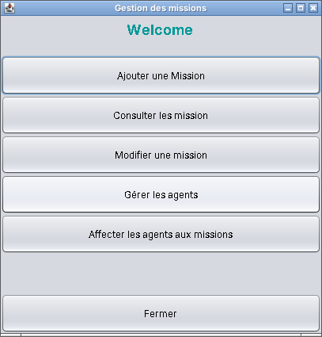

*Figure 1 — Menu principal. Les deux nouveaux boutons « Gérer les agents » et « Affecter les
agents aux missions » donnent accès aux fonctionnalités du TP2.*

Quand une fenêtre est ouverte depuis le menu, celui-ci se masque ; il réapparaît dès que la
fenêtre est fermée (bouton **Retour** ou croix).

---

## 2. Gérer les agents

Cliquez sur **Gérer les agents**.

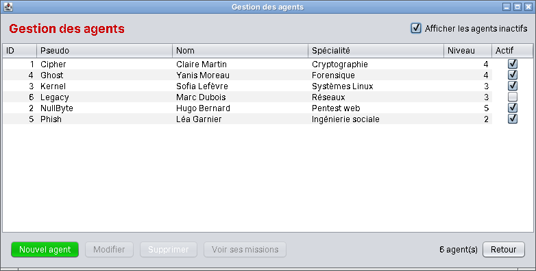

*Figure 2 — Fenêtre « Gestion des agents ». Chaque ligne est un agent ; la colonne « Actif »
indique s'il peut être affecté à une mission. Cliquez sur un en-tête de colonne pour trier.*

- La case **Afficher les agents inactifs** permet de masquer les agents désactivés.
- Les boutons **Modifier**, **Supprimer** et **Voir ses missions** s'activent dès qu'un agent
  est sélectionné.

### 2.1 Créer un agent

1. Cliquez sur **Nouvel agent** : une fenêtre de saisie s'ouvre (la liste reste bloquée tant
   qu'elle est ouverte).
2. Renseignez le **pseudo** (unique, sans espace), le **nom**, la **spécialité** (choisie dans la
   liste ou saisie librement) et le **niveau** (1 à 5).
3. Laissez **Agent actif** coché pour pouvoir l'affecter à des missions.
4. Cliquez sur **Enregistrer** (ou appuyez sur Entrée). **Annuler** (ou Échap) ferme la fenêtre
   sans rien enregistrer.

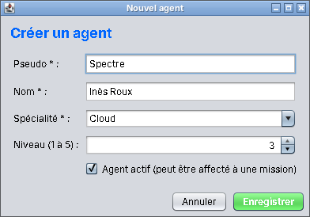

*Figure 3 — Création de l'agent « Spectre ». Les champs marqués d'un astérisque sont
obligatoires.*

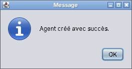

*Figure 4 — Message de confirmation ; le nouvel agent apparaît aussitôt dans la liste.*

### 2.2 Modifier un agent

Sélectionnez l'agent puis cliquez sur **Modifier** (ou double-cliquez sur la ligne). Le
formulaire s'ouvre pré-rempli ; modifiez les valeurs puis cliquez sur **Enregistrer**.

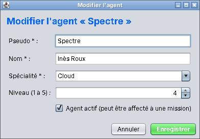

*Figure 5 — Modification de l'agent « Spectre » : son niveau passe à 4.*

### 2.3 Consulter les missions d'un agent

Sélectionnez un agent puis cliquez sur **Voir ses missions**.

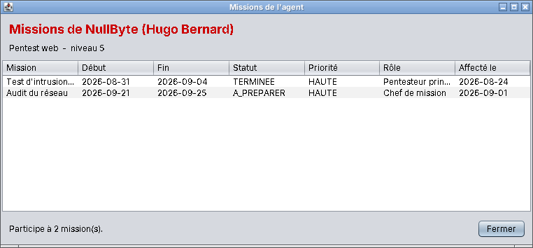

*Figure 6 — Missions de l'agent NullByte, avec pour chacune son rôle et sa date d'affectation.*

### 2.4 Supprimer ou désactiver un agent

Sélectionnez l'agent puis cliquez sur **Supprimer** et confirmez. Si l'agent est affecté à des
missions, l'application indique combien d'affectations seront supprimées avec lui.

Pour **conserver l'historique** de ses missions, préférez le **désactiver** : ouvrez-le avec
**Modifier** et décochez **Agent actif**. Il ne sera plus proposé lors des nouvelles
affectations.

---

## 3. Affecter les agents aux missions

Depuis le menu, cliquez sur **Affecter les agents aux missions**.

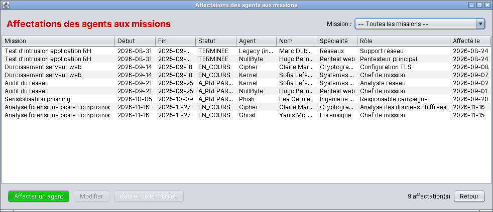

*Figure 7 — Toutes les affectations : mission, dates, statut, agent, rôle et date
d'affectation. Un agent inactif est signalé par la mention « (inactif) ».*

### 3.1 Affecter un agent à une mission

1. Cliquez sur **Affecter un agent**.
2. Choisissez la **mission**. La liste **Agent** se met à jour : elle ne propose que les agents
   **actifs** qui ne sont **pas encore affectés** à cette mission.
3. Choisissez l'**agent**, saisissez ou choisissez son **rôle**.
4. Vérifiez la **date d'affectation** (date du jour par défaut, format `AAAA-MM-JJ`) ; elle ne
   doit pas dépasser la date de fin de la mission.
5. Cliquez sur **Enregistrer**.

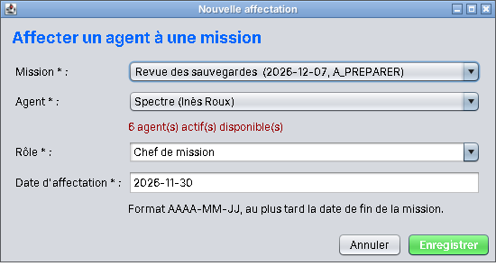

*Figure 8 — Affectation de l'agent « Spectre » comme chef de mission sur « Revue des
sauvegardes ». Le nombre d'agents disponibles est indiqué sous la liste.*

> Astuce : si une mission est sélectionnée dans le filtre (voir ci-dessous), elle est
> pré-sélectionnée dans le formulaire.

### 3.2 Filtrer les affectations par mission

Choisissez une mission dans la liste **Mission** en haut à droite pour n'afficher que ses
agents ; choisissez **-- Toutes les missions --** pour revenir à la liste complète.

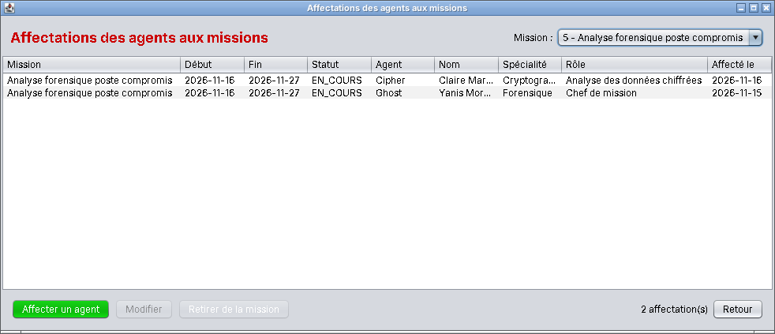

*Figure 9 — Affectations de la mission « Analyse forensique poste compromis ».*

### 3.3 Modifier une affectation

Sélectionnez l'affectation puis cliquez sur **Modifier** (ou double-cliquez). Seuls le **rôle**
et la **date** sont modifiables : l'agent et la mission sont grisés. Pour changer d'agent,
retirez l'affectation puis créez-en une nouvelle.

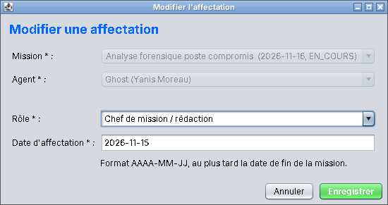

*Figure 10 — Modification du rôle de l'agent Ghost.*

### 3.4 Retirer un agent d'une mission

Sélectionnez l'affectation puis cliquez sur **Retirer de la mission** et confirmez. Seule
l'affectation est supprimée : l'agent et la mission sont conservés.

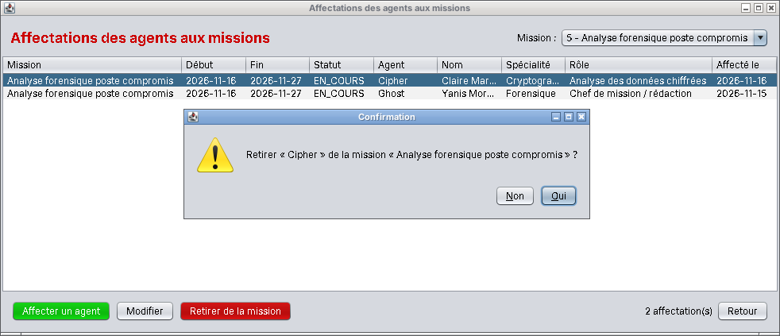

*Figure 11 — Demande de confirmation avant de retirer l'agent Cipher de la mission.*

---

## 4. Consulter les agents mobilisés sur une mission

Depuis le menu, cliquez sur **Consulter les missions**. La nouvelle colonne **Agents** indique le
nombre d'agents affectés à chaque mission.

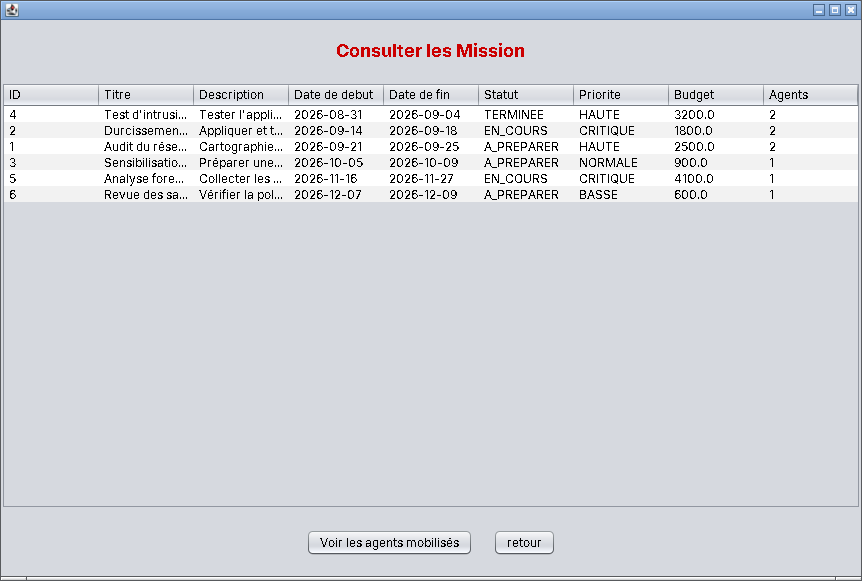

*Figure 12 — Liste des missions avec le nombre d'agents mobilisés.*

Sélectionnez une mission puis cliquez sur **Voir les agents mobilisés** :

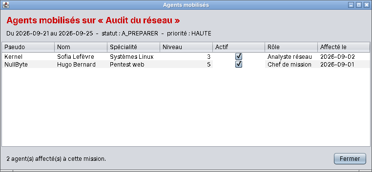

*Figure 13 — Agents mobilisés sur la mission « Audit du réseau », avec leur rôle et leur date
d'affectation.*

Comme au TP1, un double-clic sur une mission ouvre la fenêtre de modification. Lors d'une
suppression, l'application précise combien d'affectations seront supprimées avec la mission :

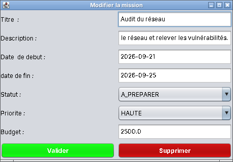

*Figure 14 — Fenêtre de modification d'une mission (TP1).*

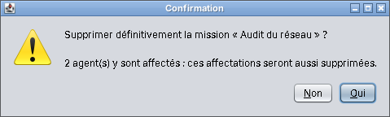

*Figure 15 — Avertissement : supprimer la mission supprime aussi ses 2 affectations.*

---

## 5. Messages d'erreur

Les saisies sont vérifiées avant l'enregistrement. En cas de problème, un message explique quoi
corriger et la fenêtre de saisie reste ouverte.

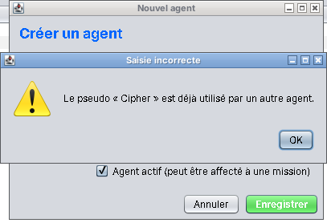

*Figure 16 — Le pseudo d'un agent doit être unique : « Cipher » existe déjà.*

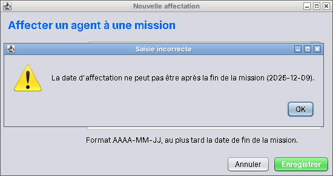

*Figure 17 — La date d'affectation ne peut pas être postérieure à la fin de la mission.*

| Message | Cause | Solution |
|---|---|---|
| « Le pseudo, le nom et la spécialité sont obligatoires. » | champ vide | compléter le formulaire |
| « Le pseudo ne doit contenir que des lettres, des chiffres… » | espace ou caractère spécial dans le pseudo | utiliser par exemple `Null_Byte` |
| « Le pseudo « X » est déjà utilisé par un autre agent. » | pseudo en double | choisir un autre pseudo |
| « La date doit être au format AAAA-MM-JJ » | date mal saisie | par exemple `2026-11-30` |
| « La date d'affectation ne peut pas être après la fin de la mission » | date trop tardive | saisir une date antérieure |
| « Impossible d'affecter un agent à une mission annulée. » | mission au statut ANNULEE | choisir une autre mission |
| « Tous les agents actifs sont déjà affectés à cette mission. » | aucun agent disponible | créer ou réactiver un agent |
| « Connexion à la base impossible… » | serveur MySQL arrêté | démarrer MySQL (WAMP, XAMPP…) puis relancer |
| « La base gestion_missions n'existe pas… » / « Une table est manquante… » | script SQL non exécuté | exécuter `sql/gestion_missions.sql` |
